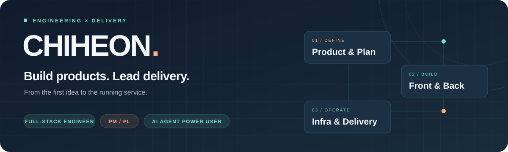

  

<h2 align="center">안녕하세요, 이치헌입니다.</h2>

  <strong>기획에서 개발, 배포와 운영까지 제품의 전체 흐름을 연결합니다.</strong> 
  백엔드 · 프론트엔드 · 인프라 개발과 PM · PL 업무를 함께 맡고 있습니다.

  <a href="#what-i-do">What I do</a> &nbsp;·&nbsp;
  <a href="#tech-stack">Tech stack</a> &nbsp;·&nbsp;
  <a href="#selected-projects">Projects</a>

 

## What I do

<table>
  <tr>
    <td width="50%" valign="top">
      <h3>01 &nbsp; Backend</h3>
      API와 데이터 모델을 설계하고, 서비스의 핵심 로직을 구현합니다.  
      <code>Java / Spring Boot</code> <code>Python / Django</code>
    </td>
    <td width="50%" valign="top">
      <h3>02 &nbsp; Frontend</h3>
      사용자 화면부터 관리자 도구까지, 실제 업무 흐름에 맞는 인터페이스를 만듭니다.  
      <code>React / Next.js</code> <code>TypeScript</code>
    </td>
  </tr>
  <tr>
    <td width="50%" valign="top">
      <h3>03 &nbsp; Infrastructure</h3>
      배포 환경과 CI/CD를 구성하고, 서비스가 안정적으로 운영되도록 관리합니다.  
      <code>AWS</code> <code>Docker</code> <code>GitHub Actions</code>
    </td>
    <td width="50%" valign="top">
      <h3>04 &nbsp; PM / PL</h3>
      요구사항과 우선순위를 정리하고, 일정·협업·기술 의사결정을 개발과 연결합니다.  
      <code>Planning</code> <code>Delivery</code> <code>Technical Leadership</code>
    </td>
  </tr>
</table>

 

## Tech stack

  
  
  
  
  
  

| Area | Technologies |
| :--- | :--- |
| **Languages** | TypeScript · JavaScript · Java · Python · Kotlin · Dart |
| **Web** | React · Next.js · Vite · Tailwind CSS · Zustand |
| **Backend** | Spring Boot · Spring Security · JPA · QueryDSL · Django · Django REST Framework |
| **Data** | PostgreSQL · MariaDB / MySQL · Supabase · Neon |
| **Infra & Delivery** | AWS · Docker · GitHub Actions · Vercel |
| **Mobile** | Android · Kotlin · Jetpack · Flutter · Firebase |

프로젝트의 의존성, 구성 파일과 문서에서 확인한 사용 기술을 정리했습니다.

 

## Selected projects

<table>
  <tr>
    <td width="50%" valign="top">
      <h3><a href="https://github.com/Cheetozzeong/MiriQ">MiriQ ↗</a></h3>
      <strong>3쿠션 샷 예측 시뮬레이터</strong>
      
공의 배치와 방향·힘·당점을 바탕으로 샷 결과를 시뮬레이션하고, 추천 샷을 탐색하는 웹 앱입니다.

      <code>TypeScript</code> <code>Vite</code> <code>Neon</code> <code>Vercel</code>
    </td>
    <td width="50%" valign="top">
      <h3><a href="https://github.com/Cheetozzeong/pharmfarm">PharmFarm ↗</a></h3>
      <strong>약국 재고 업무를 연결하는 웹 앱</strong>
      
재고 스캔, 입고와 반품 공급처 조회 흐름을 지원합니다. 모바일에서는 WebView로 웹 서비스를 연결합니다.

      <code>React</code> <code>TypeScript</code> <code>Vite</code> <code>Vercel</code>
    </td>
  </tr>
</table>

### Beyond public repositories

웹 서비스와 관리자 도구, 백엔드 API, 배포 자동화 등 다양한 프로젝트를 작업하고 있습니다.  
개발과 함께 PM·PL 역할을 수행하며, 요구사항을 정리하는 단계부터 운영까지 함께합니다.

  
<strong>Earlier work · 모바일 프로젝트 보기</strong>

 

| Project | Overview | Stack |
| :--- | :--- | :--- |
| [It's Grey](https://github.com/Cheetozzeong/ItsGrey) | 머신 러닝 기반 스케치를 제공하는 드로잉 앱 | Kotlin · Android |
| [Artwalk / 귿다](https://github.com/Cheetozzeong/Artwalk) | GPS 이동 경로로 지도 위에 그림을 그리는 앱 | Kotlin · Jetpack · Mapbox |
| [티끌태끌토끌](https://github.com/Cheetozzeong/TTT) | 습관 기록과 알림, 웨어러블 연동을 지원하는 앱 | Flutter · Dart · Kotlin |

 

<strong>Vincere Certe.</strong> &nbsp; Keep building. Keep improving.

